# Lab 25B — Sơ đồ Kiến trúc & Luồng Xử lý Hệ thống (UML Workflows)

Tài liệu này đặc tả toàn bộ các luồng nghiệp vụ (workflows), kiến trúc phân lớp, máy trạng thái (state machines), và cơ chế xử lý lỗi bền bỉ trong **Lab 25B: Circuit Breakers, Caching, Reliability & SRE Error Budgets**.

Mỗi quy trình được mô hình hóa bằng chuẩn **Mermaid UML** (hiển thị trực tiếp trong VS Code / GitHub Markdown) và đi kèm **PlantUML Source Code**.

---

## Mục Lục

1. [Tổng quan Kiến trúc Hệ thống (Component Architecture)](#1-tổng-quan-kiến-trúc-hệ-thống)
2. [Luồng Xử lý Yêu cầu Đa tầng Resilient LLM Routing (Sequence Diagram)](#2-luồng-xử-lý-yêu-cầu-đa-tầng-resilient-llm-routing)
3. [Máy trạng thái Circuit Breaker Cửa sổ Trượt (State Machine Diagram)](#3-máy-trạng-thái-circuit-breaker-cửa-sổ-trượt)
4. [Luồng Xử lý Workflow Hoàn tiền Chính xác Một Lần — Exactly-Once (Sequence Diagram)](#4-luồng-xử-lý-workflow-hoàn-tiền-chính-xác-một-lần--exactly-once)
5. [Cơ chế Phục hồi khi Gặp Crash & Idempotency (Activity Diagram)](#5-cơ-chế-phục-hồi-khi-gặp-crash--idempotency)
6. [Công cụ Cảnh báo SRE Multi-Window Multi-Burn-Rate (Sequence Diagram)](#6-công-cụ-cảnh-báo-sre-multi-window-multi-burn-rate)
7. [Sơ đồ Lớp Toàn diện (Class Diagram)](#7-sơ-đồ-lớp-toàn-diện)

---

## 1. Tổng quan Kiến trúc Hệ thống

Sơ đồ thể hiện sự phối hợp giữa các tầng: **Client Layer**, **Caching Layer**, **Resilience Layer (Retry/Breaker)**, **Durable Workflow Engine**, và **SRE Monitoring Engine**.

### Mermaid Diagram
```mermaid
graph TD
    User([Người dùng / Agent Task]) --> CachedClient[CachedClient\n(Semantic Cache)]
    
    subgraph "Caching Layer (Part G)"
        CachedClient -->|Cosine Similarity >= 0.92| CacheHit{Kiểm tra Cache?}
        CacheHit -->|Fresh: age <= 60s| ReturnCached([Trả lời từ Cache - 0ms, 0$])
        CacheHit -->|Miss / Stale| ResilientClient[ResilientClient\n(Multi-Provider Router)]
        CacheHit -->|Upstream All Fail & age <= 300s| ServeStale([Stale-If-Error Fallback])
    end

    subgraph "Resilience Layer (Parts A, B, C)"
        ResilientClient --> RetryBudgetCheck{Retry Budget\nToken Available?}
        RetryBudgetCheck -->|Yes| ProviderSelection[Chọn Provider theo Ladder:\nPrimary -> Secondary -> Fallback]
        RetryBudgetCheck -->|Exhausted| GiveUpBudget([GiveUp: retry_budget_exhausted])
        
        ProviderSelection --> BreakerCheck{Circuit Breaker\nState?}
        BreakerCheck -->|OPEN| Failover[Chuyển Provider tiếp theo]
        BreakerCheck -->|CLOSED / HALF-OPEN| DispatchProvider[Gửi yêu cầu tới Provider]
        
        DispatchProvider --> ErrorClassifier{Phân loại phản hồi\nErrorKind}
        ErrorClassifier -->|Success| RecordSuccess[Breaker.on_success\nBudget.record_success]
        ErrorClassifier -->|Rate-Limited / Overloaded| RetryWithJitter[FullJitterBackoff\nThử lại cùng Provider]
        ErrorClassifier -->|Timeout / 5xx Crash| BreakerFail[Breaker.on_failure\nFailover Provider tiếp]
    end

    subgraph "Durable Workflow Layer (Part D)"
        WorkflowTask([Yêu cầu Hoàn tiền RefundRequest]) --> WorkflowExec[Durable Workflow Executor]
        WorkflowExec <--> DurableStore[(DurableStore\nCheckpoints & Idempotency Keys)]
        WorkflowExec --> Step1[Step 1: lookup_policy]
        WorkflowExec --> Step2[Step 2: call_llm_judge]
        WorkflowExec --> Step3[Step 3: ledger_debit]
        WorkflowExec --> Step4[Step 4: gateway_refund]
        WorkflowExec --> Step5[Step 5: send_email]
        WorkflowExec --> Step6[Step 6: record_audit]
    end

    subgraph "SRE Alerting & SLO Engine (Part E)"
        TimeSeriesData[(Tập dữ liệu SLI 30 ngày\n43.200 phút)] --> WindowSums[WindowSums: O(1) Prefix Sums]
        WindowSums --> MultiBurnRate[Bộ đánh giá Multi-Burn-Rate]
        MultiBurnRate --> AlertEngine{Kiểm tra 4 Bậc Rule}
        AlertEngine -->|14.4x burn (1h & 5m)| PageUrgent([PAGER: Khẩn cấp - Mất 2% budget/1h])
        AlertEngine -->|6.0x burn (6h & 30m)| PageSevere([PAGER: Nghiêm trọng - Mất 5% budget/6h])
        AlertEngine -->|3.0x burn (24h & 2h)| TicketWarning([TICKET: Cảnh báo - Mất 10% budget/ngày])
        AlertEngine -->|1.0x burn (72h & 6h)| TicketTrend([TICKET: Xu hướng - Mất 10% budget/3 ngày])
    end
```

<details>
<summary><b>Nhấn để xem mã nguồn PlantUML</b></summary>

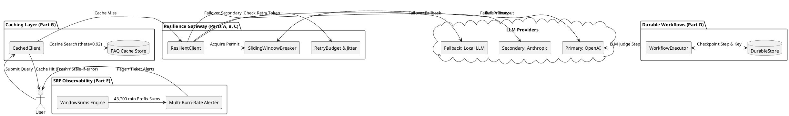
</details>

---

## 2. Luồng Xử lý Yêu cầu Đa tầng Resilient LLM Routing

Sơ đồ trình tự biểu diễn chi tiết cách một lệnh gọi LLM được bảo vệ bởi **Semantic Cache**, **Retry Budget**, **Circuit Breaker per-provider**, và **Fallback Ladder** khi nhà cung cấp chính gặp sự cố (Rate Limit, Quota, Timeout).

### Mermaid Diagram
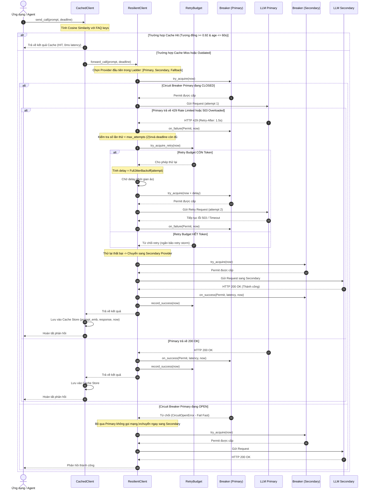

<details>
<summary><b>Nhấn để xem mã nguồn PlantUML</b></summary>

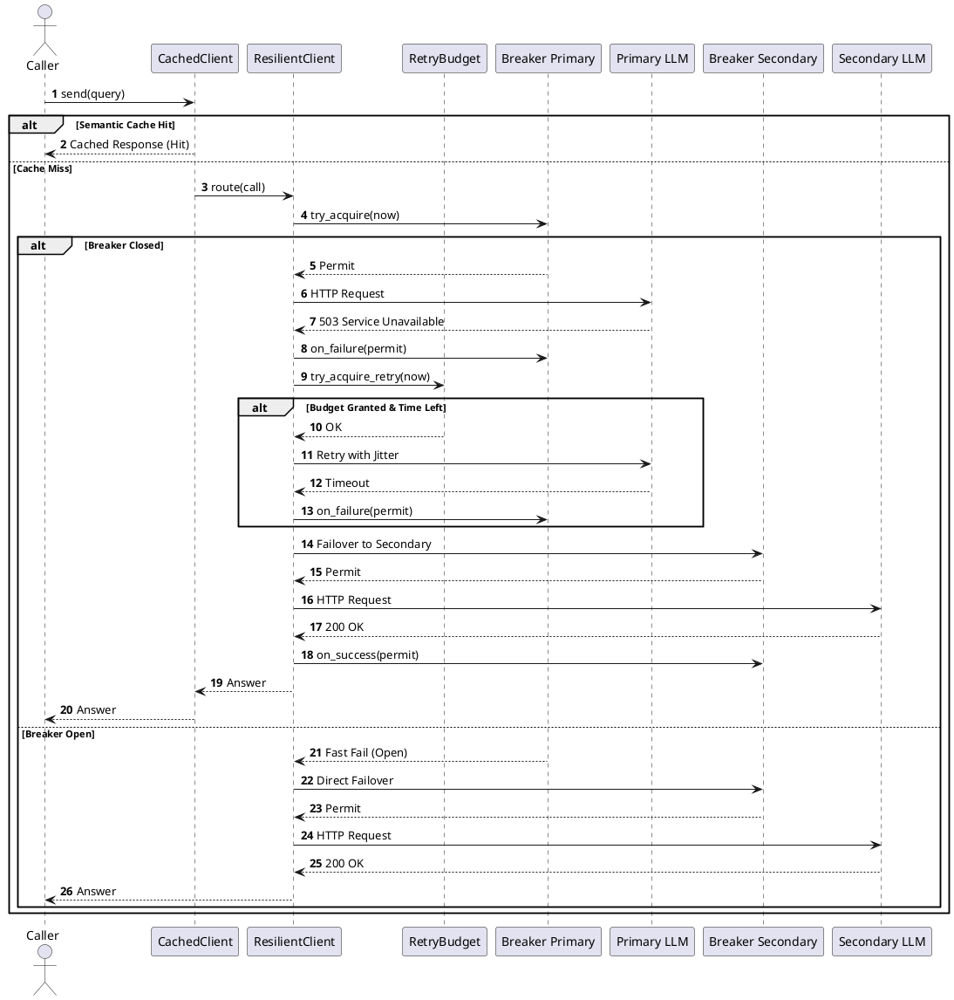
</details>

---

## 3. Máy trạng thái Circuit Breaker Cửa sổ Trượt

Trạng thái và logic chuyển đổi của `SlidingWindowBreaker` gồm 3 trạng thái chuẩn: **CLOSED**, **OPEN**, và **HALF_OPEN**.

### Mermaid Diagram
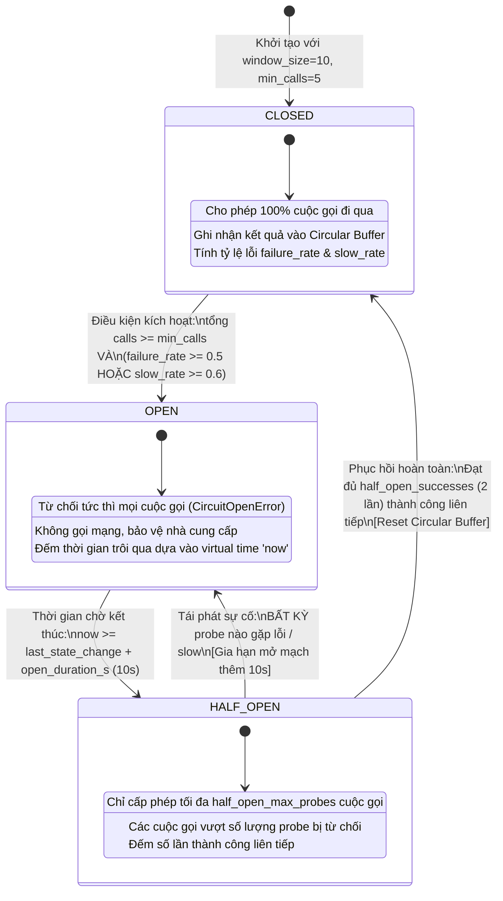

<details>
<summary><b>Nhấn để xem mã nguồn PlantUML</b></summary>

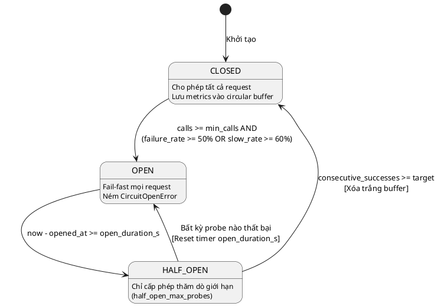
</details>

---

## 4. Luồng Xử lý Workflow Hoàn tiền Chính xác Một Lần — Exactly-Once

Quy trình xử lý hoàn tiền 6 bước bền vững (`RefundRequest`) có checkpointing tại từng bước và sinh **Idempotency Key** theo định dạng `session_id:step`.

### Mermaid Diagram
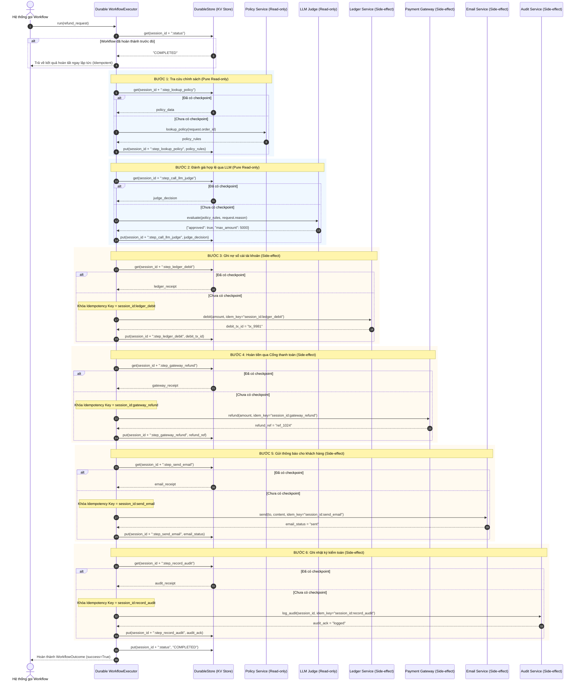

---

## 5. Cơ chế Phục hồi khi Gặp Crash & Idempotency

Sơ đồ khối thể hiện cách `execute_step` xử lý khi tiến trình bị sập nguồn (Crash) hoặc gặp sự cố mạng (ServiceTimeout / 500 error).

### Mermaid Diagram
```mermaid
flowchart TD
    Start([Bắt đầu thực hiện Bước i]) --> CheckStore{DurableStore đã lưu\ncheckpoint bước i chưa?}
    
    CheckStore -->|Đã có kết quả| UseCached[Tái sử dụng kết quả đã checkpoint\nBỏ qua không gọi lại dịch vụ]
    UseCached --> NextStep([Chuyển sang Bước tiếp theo])

    CheckStore -->|Chưa có| GenKey[Sinh Idempotency Key:\nsession_id + ':' + step_name]
    GenKey --> CallService[Gọi Dịch vụ bên ngoài với idem_key]

    CallService --> ResultEval{Kết quả thực thi}

    ResultEval -->|Crash trước khi gửi yêu cầu| CrashBefore[Tiến trình bị hủy]
    CrashBefore -.->|Worker khởi động lại| Start

    ResultEval -->|Timeout / Lỗi mạng| HandleTimeout[Bắt ngoại lệ ServiceTimeout]
    HandleTimeout --> RetryStep[Thử lại chính xác với idem_key cũ]
    RetryStep --> CallService

    ResultEval -->|Dịch vụ xử lý xong & Crash trước khi Checkpoint| CrashMid[Tiến trình bị hủy]
    CrashMid -.->|Worker khởi động lại| Start
    NoteMid[Dịch vụ nhận lại idem_key cũ ->\nTrả lại kết quả ban đầu mà KHÔNG trừ tiền lần 2]
    CrashMid --- NoteMid

    ResultEval -->|Thành công trả về kết quả| SaveStore[Lưu checkpoint vào DurableStore:\nstore.put session_id:step, result]
    SaveStore --> NextStep
```

<details>
<summary><b>Nhấn để xem mã nguồn PlantUML</b></summary>

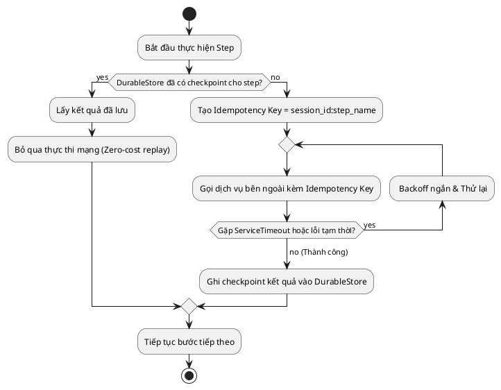
</details>

---

## 6. Công cụ Cảnh báo SRE Multi-Window Multi-Burn-Rate

Quy trình đánh giá chuỗi thời gian 43.200 phút giả lập sử dụng **Prefix Sums** $O(1)$ và 4 bộ quy tắc đa cửa sổ (Multi-Window Multi-Burn-Rate) theo chuẩn Google SRE.

### Mermaid Diagram
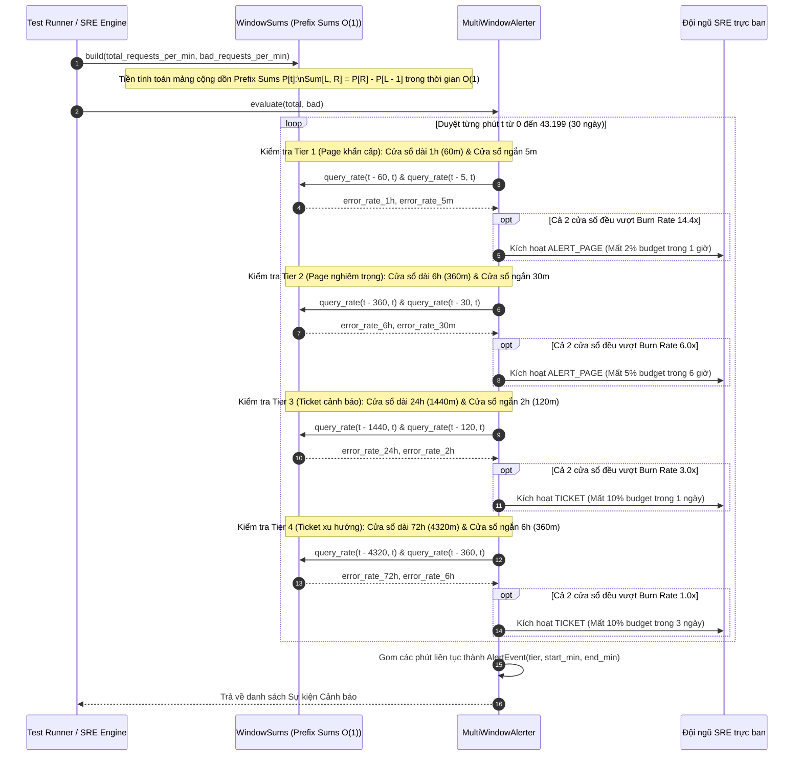

---

## 7. Sơ đồ Lớp Toàn diện

Biểu đồ lớp thể hiện toàn bộ các thực thể, thuộc tính và phương thức cốt lõi được hiện thực trong gói `src/gameday_lab/`.

### Mermaid Diagram
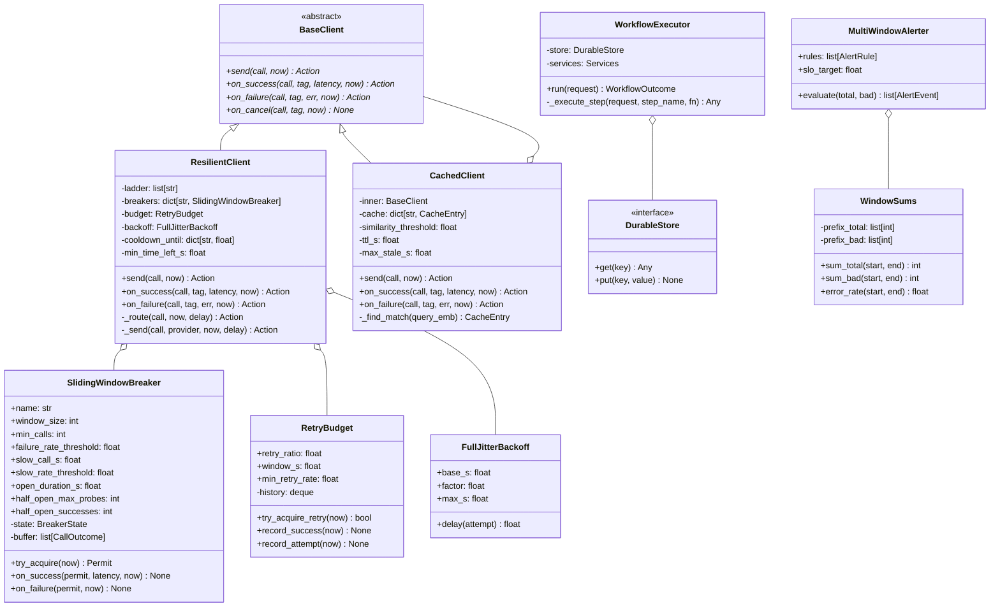

<details>
<summary><b>Nhấn để xem mã nguồn PlantUML</b></summary>

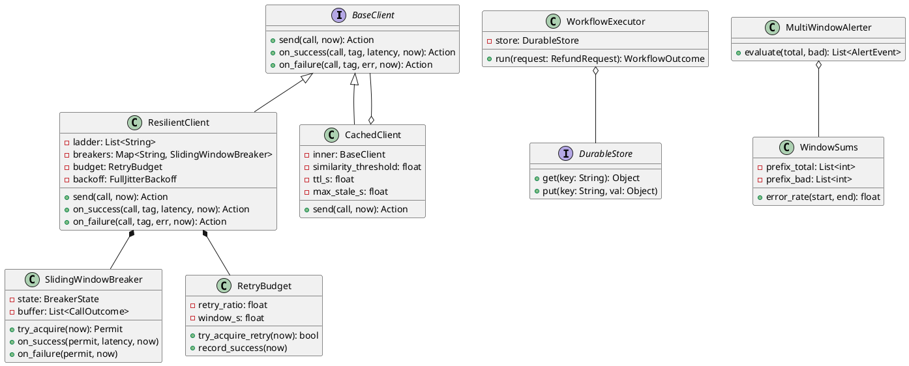
</details>

---

## 8. Hướng dẫn Sử dụng & Trực quan hóa

1. **Xem trực tiếp trong IDE / VS Code:**
   - Mở file `WORKFLOW_UML.md`.
   - Nhấn tổ hợp phím `Ctrl + Shift + V` (hoặc click icon Preview ở góc phải trên) để mở Markdown Preview. Toàn bộ các diagram Mermaid sẽ tự động render dạng đồ họa tương tác.
2. **Xem dạng PlantUML:**
   - Nếu máy tính có cài extension PlantUML trong VS Code, mở khối code trong phần `<details>` tương ứng và nhấn `Alt + D` để render sơ đồ PlantUML.
